# Créer un compte GitHub

## Question 1

Rendez-vous sur le site web [GitHub](https://github.com). Rentrez votre adresse e-mail puis cliquez sur le bouton "Inscrivez-vous sur GitHub"

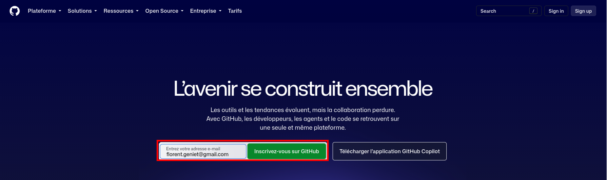


<div style="font-size: 0.8em;">

::: {.callout-important}
N'utilisez pas votre adresse e-mail Géodata Paris pour créer votre compte GitHub. Cette adresse sera supprimée à la fin de votre scolarité.
:::

</div>

## Question 2

Remplissez le formulaire avec les informations requises puis finalisez l'inscription. 


## Question 3

Connectez vous ensuite sur votre nouveau compte. Vous arrivez sur une page d'accueil ressemblant à l'image ci-dessous.

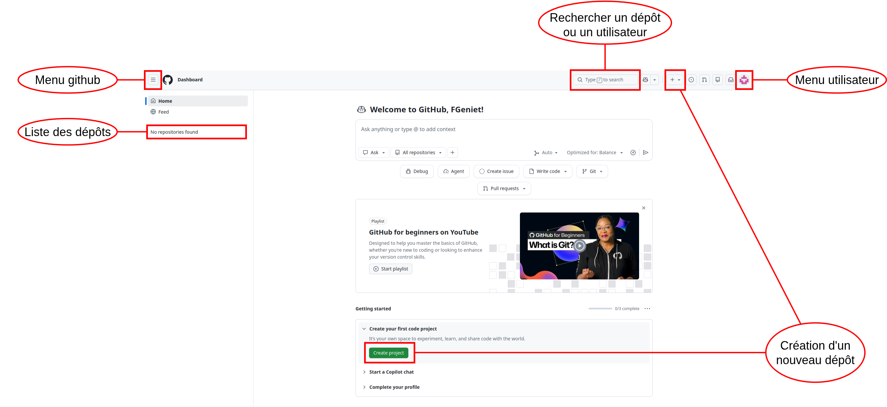


# Créer un token Github

## Question 4

**Allez dans le menu utilisateur, sélectionnez les paramètres, puis allez dans la section "Credentials". **Vous arrivez sur un menu permettant de gérer les options d'identifications.

##

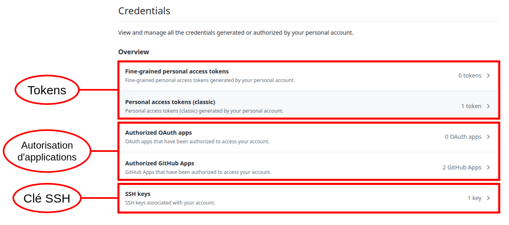

## Authentification avec GitHub

Pour cloner un dépôt privé ou pousser des modifications vers GitHub, il faut s'authentifier.

GitHub n'autorise plus l'authentification par mot de passe pour les opérations Git.

Plusieurs solutions existent :

- Token d'accès (PAT)
- Autorisation d'une application
- Clé SSH

## Token d'accès personnel (PAT)

- Mot de passe généré automatiquement
- Droits configurables
- Plusieurs tokens possibles par compte

## Application autorisée

- Connexion via GitHub
- L'application reçoit une autorisation
- Plus besoin de saisir ses identifiants ensuite

## Authentification par SSH

Le protocole SSH repose sur une paire de clés :

- Clé privée : conservée sur votre ordinateur
- Clé publique : transmise à GitHub

GitHub utilise votre clé publique pour vérifier votre identité et sécuriser les échanges.


## Question 5


1. Sélectionnez l'option "personnal access token (classic)"
2. choisissez "generate new token (classic)". Donnez un nom au token, et sélectionnez les actions que ce token doit permettre d'effectuer

Dans notre cas, on se contentera des actions liées aux repositories (option "repo"). 
 
3. Ensuite validez en cliquant sur "generate token".

##

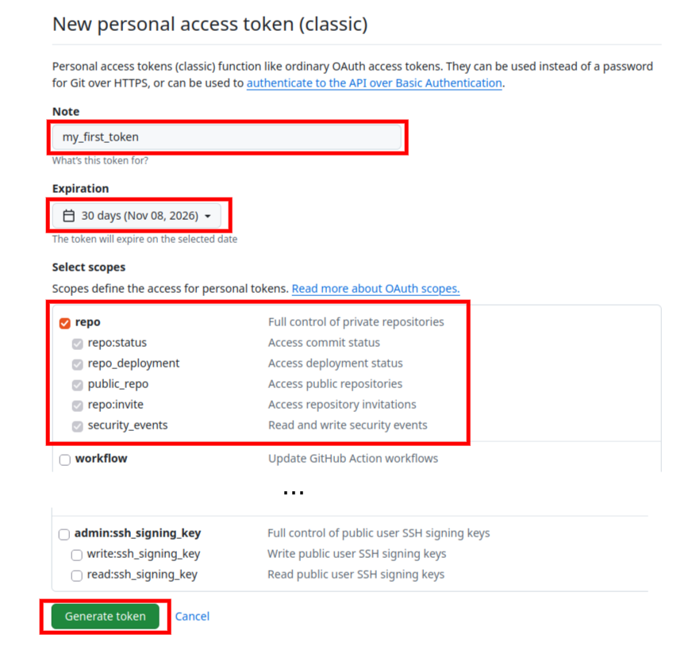

##

4. Copiez ensuite le token et collez le dans un nouveau fichier texte.

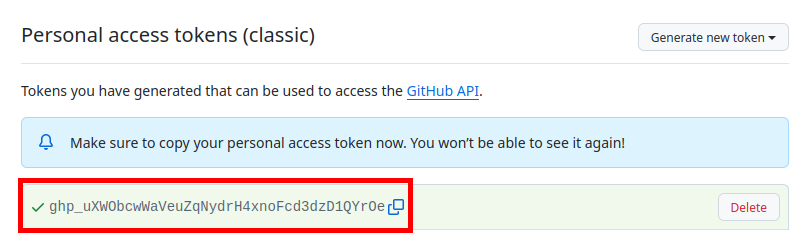

# Création d'un nouveau dépôt sur GitHub

## Question 6

On va créer un dépôt git, mais contrairement au cours 2, on va le faire directement sur GitHub. 

1. **Cliquez sur le bouton "Create project"**. Une nouvelle fenêtre s'ouvre pour paramétrer votre nouveau dépôt.
2. **Créez un dépôt <u>privé</u> avec un <u>README généré automatiquement</u>.**

##
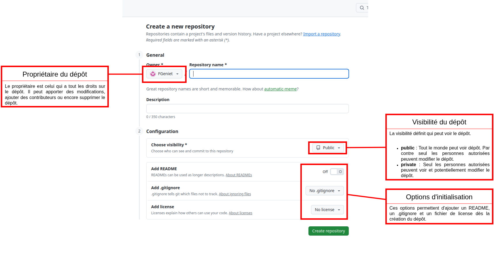

## Question 7

**Récupérez le projet sur votre ordinateur grâce à la commande `git clone`.**

::: {.fragment}


```bash
git clone https://github.com/vanou-suerte/tp-de-flow.git
```

:::


# Communication entre GitHub et un dépôt local


## Question 8

**En local sur votre ordinateur, créez une nouvelle branche _develop_ et placez vous sur cette branche.**

::: {.fragment}

```bash
git switch -c develop
```

:::

## Question 9

**Écrivez une description du projet dans le README.** 

```md
# Description
Le projet consistera en une bibliothèque de calcul géométrique.
```

## Question 10

**Faites un commit avec ce changement, puis poussez ces changements avec la commande `git push`.** 

Vous obtenez un message d'erreur : `fatal: The current branch develop has no upstream branch`. Cette erreur se produit car on essaie de pousser une branche qui n'existe pas encore sur le dépôt GitHub.

## Probleme

Pour régler ce problème, il faut indiquer à git de créer une nouvelle branche équivalente sur le dépôt GitHub. On fait ça en rajoutant l'options `--set-upstream origin develop` à la commande `push`.

Le terme `origin` désigne le serveur à partir duquel on a cloné notre dépôt, ici il s'agit de GitHub. 


- **Lancez la commande , puis retournez sur la page d'accueil de votre projet sur github et rechargez la.** Le README affiché sur cette page d'accueil a-t-il changé ? Si non, que faire pour afficher la nouvelle version ?


## Question 11

**Créez une nouvelle branche _calcul_de_distances_ sur votre projet dans github.** Attention à bien prendre la branche _develop_ comme source de cette nouvelle branche.

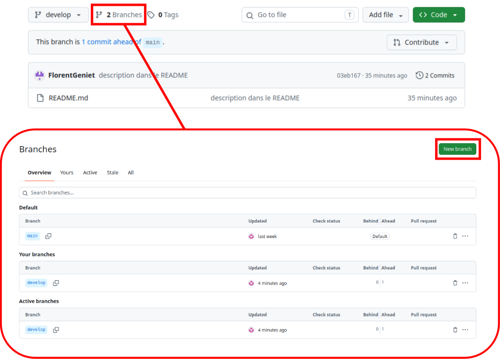

## Question 12

**Toujours sur GitHub, assurez-vous que vous êtes bien sur la nouvelle branche, puis modifiez le README pour ajouter une section "fonctionnalités" contenant une liste à puces avec un item "calcul des distances".**


## Question 13

- Sur votre dépôt local, récupérez les modifications avec la commande `git pull`
- puis placez vous dans la branche _calcul_des_distances_


::: {.fragment}

```bash
git switch calcul_des_distances
```

:::


## Question 14


- Créez un dossier `src`,
- puis créez un fichier `calcul_distances.py` dans le dossier `src`. 
- Dans ce fichier, créez une fonction calculant la distance entre deux points 3D 

(vous pourrez vous aider de la bibliothèque `math` pour calculer le calcul de la racine carrée). 

La signature de la fonction est :

```python
def distance_pt_pt(coords1, coords2):
```


## Question 15

**Faites un commit, puis poussez vos modifications sur GitHub.**


**Retournez sur github. Créez une `pull request` pour fusionner la branche _calcul_de_distances_ dans la branche _develop_.**

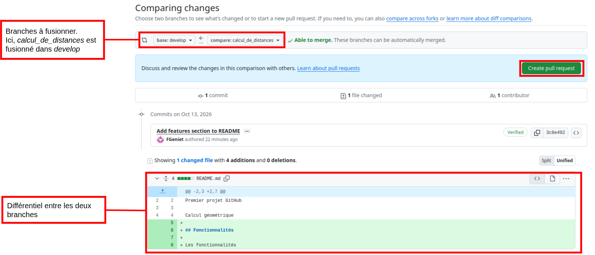

***

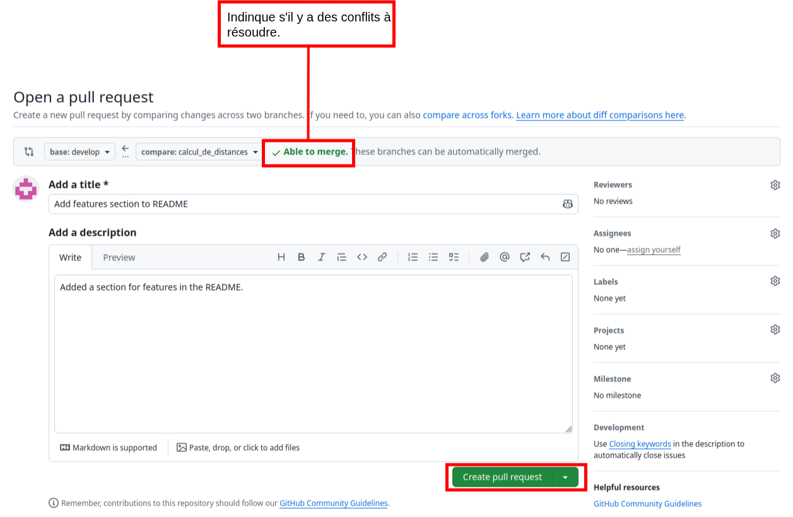

***

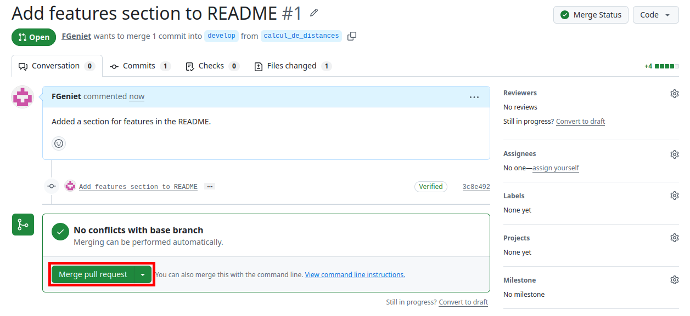

## Question 16

- **Retournez sur votre dépôt local.** 

- <u>Ne faites PAS de `git pull` pour l'instant !</u> 

- Déplacez vous sur la branche _develop_, puis créez une nouvelle branche _calcul_perimetre_. 

- Recréez le dossier `src`, puis créez dedans un fichier `calcul_perimetre.py`, et copiez le code suivant dedans :

```python
def perimetre_polygone(coords):
    pass
```

## Question 17

**Faites un commit, puis replacez vous dans la branche _develop_.**

## Question 18

**Faites une fusion de _calcul_perimetre_ dans _develop_.**

## Question 19

**Poussez vos modifications.** Vous obtenez une erreur car vous ne pouvez pas pousser des modifications sur un dépôt distant si votre dépôt n'est pas à jour avec ce dépôt.

**Pour régler ce problème, faites un `git pull`, puis retentez le `git push`.**

Si vous obtenez un message d'erreur lors du `git pull` vous demandant de réconcilier des branches divergentes, tapez la commande `git config pull.rebase false`, puis retentez le `git pull` et le `git push`.


## Question 20

- Retournez sur GitHub, et placez vous dans la branche _develop_. 

- Modifiez le fichier `calcul_perimetre.py` en codant le corps de la fonction `perimetre_polygone`.

Pour cela, il faudra faire appel à la fonction `distance_pt_pt` définie dans le fichier `calcul_distances.py`.

## Question 21

**Sur votre git local, écrivez le code suivant dans le corps de la fonction `perimetre_polygone`.** 

Assurez-vous que vous êtes bien sur la branche `develop` avant de coder.

```python
# On modifie le corps de cette fonction de manière à créer un conflit lors de l'execution de la commande git pull.
    return -1
```

## Question 22

**Faites un commit avec vos changements, puis mettez votre dépôt à jour avec un pull.** 

Git essaie de fusionner les modifications, mais obtient un conflit. Il vous faut donc résoudre le conflit.

**Résolvez le conflit (en gardant la version venant de GitHub) puis validez la fusion avec la commande `git merge --continue`.**


# Supprimer toutes traces

## Question 23

**Pour finir, supprimez votre projet sur votre gitHub .**

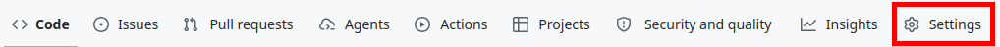

##

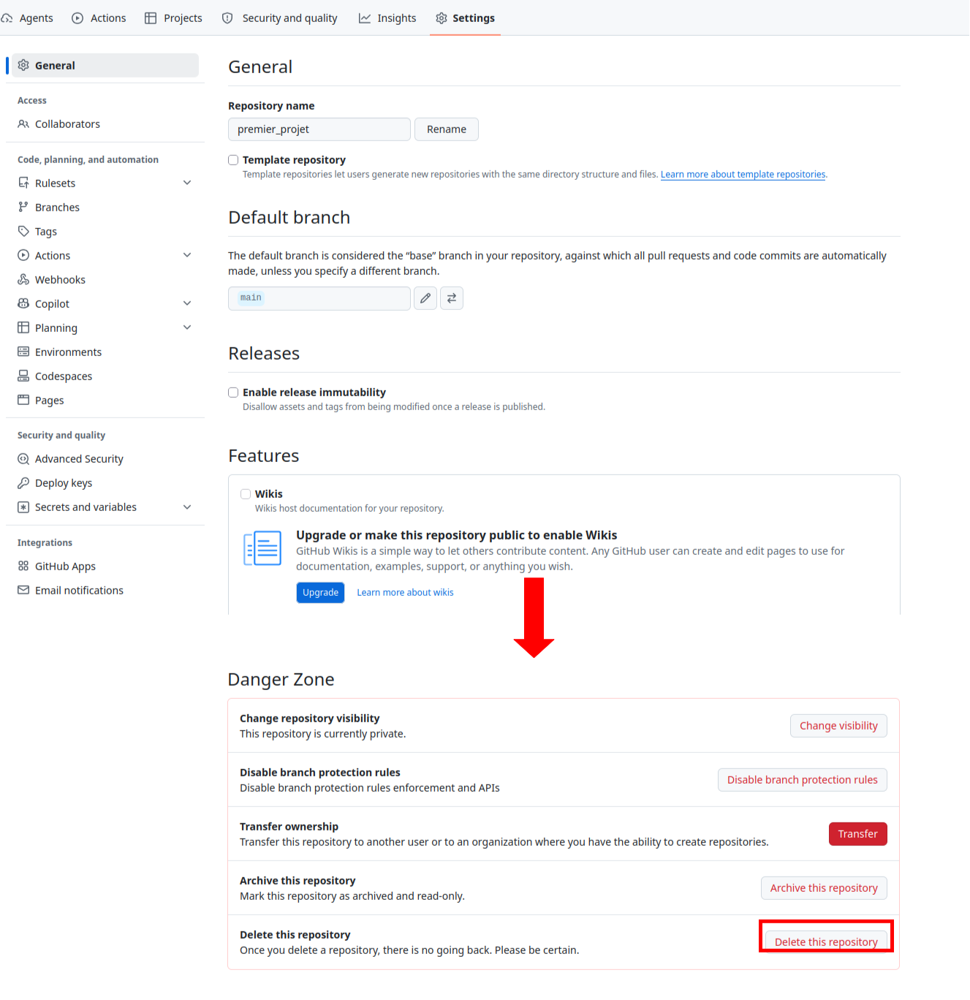

## Question 24

- Supprimer un token ou un mot de passe stocké par le Git Credential Manager sous Windows

1. Ouvrez le menu Démarrer, tapez Gestionnaire d'identification (ou Credential Manager si votre système est en anglais) et validez.
2. Cliquez sur l'onglet Informations d'identification Windows.
3. Faites défiler la liste vers le bas jusqu'à la section Informations d'identification génériques.

## 

4. Cherchez la ligne correspondant à votre hébergeur Git (par exemple : git:https://github.com ou git:https://gitlab.com).
5. Déroulez la ligne en cliquant dessus, puis cliquez sur Supprimer


# The end